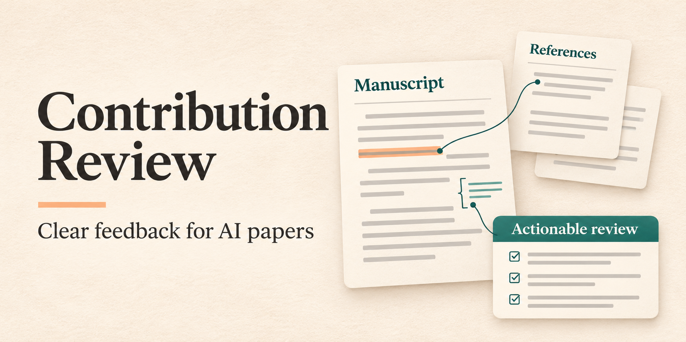
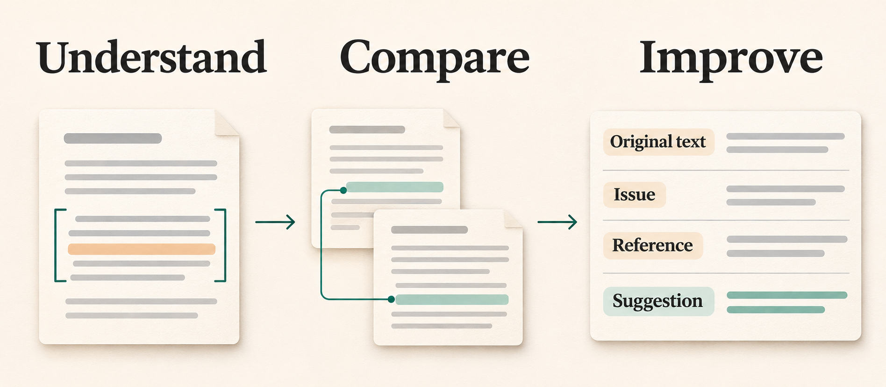

# Contribution Review

**A Codex skill for precise, source-backed feedback on AI/ML paper contributions.**

English · [简体中文](README.zh-CN.md)

[](SKILL.md)
[](references/scoring.md)
[](references/output-format.md)



Understand what the author actually adds, locate the connections that need work, and turn each judgement into an actionable edit. Relevant published papers illustrate the writing move behind the advice.

[Install locally](#install-locally) · [Try it](#quick-start) · [Read a synthetic review](examples/review.md)

## What it does

| Focus | What you get |
| --- | --- |
| **Contribution positioning** | Identify the baseline, new insight or capability, scope, and significance. Distinguish central claims, independent contributions, and supporting demonstrations. |
| **Actionable feedback** | Keep the original location and short quote beside the issue, its actual impact, a comparable paper passage, and the smallest useful revision. |
| **Source-backed examples** | Usually 1–3 primary-source exemplars chosen for the same writing task, with links and a compact sample index. |
| **Flexible requests** | Review paragraphs or lists, compare versions, or focus on one sentence. Add a rewrite, score, or JSON only when requested. |

The default task is **contribution writing and argumentation**. It uses the supplied abstract, introduction, or figures when needed to understand the claim. Full peer review, factual verification, and systematic novelty checking require a separate request. Missing experiments or proofs are not automatically writing defects; declared plans and hypotheses are evaluated at their stated status.

## Quick start

After installation, invoke the skill and provide the contribution text plus any context needed to interpret it:

```text
Use $contribution-review to review the contribution below.
Respond in English. Give a concise overview, then locate each important
issue, compare a relevant published passage, and suggest a minimal fix.

[Paste the contribution and necessary context here.]
```

Useful variations:

| Goal | Add to your prompt |
| --- | --- |
| Compare two drafts | “Review A and B independently, then explain what changed in content, strength, and scope.” |
| Request a score | “Also give a contribution-only ARR-style score and explain the nearest alternative grade.” |
| Request a rewrite | “Provide a replacement paragraph that preserves the stated facts and conditions.” |
| Get structured output | “Return JSON using `references/review-schema.json`; omit numerical scores.” |
| Work offline | “Do not browse. Review only the supplied text and mark external examples as unverified.” |

The packaged instructions are in Chinese. Request your preferred response language in the prompt.

## Install locally

This repository is a standalone skill folder. It contains instructions, references, and interface metadata; no package installation or API key is required by the skill itself. Full reviews use the web-search capability of the Codex environment.

For a personal installation, clone it into `~/.agents/skills/contribution-review`:

```bash
mkdir -p "$HOME/.agents/skills"
git clone https://github.com/hamster111111/contribution-review-skill.git \
  "$HOME/.agents/skills/contribution-review"
```

<details>
<summary>Windows PowerShell</summary>

```powershell
New-Item -ItemType Directory -Force (Join-Path $HOME ".agents/skills") | Out-Null
git clone https://github.com/hamster111111/contribution-review-skill.git (Join-Path $HOME ".agents/skills/contribution-review")
```

</details>

For a project-only installation, place the complete folder at `<project>/.agents/skills/contribution-review/` instead. Keep `SKILL.md`, `agents/`, and `references/` together.

Codex discovers local skills in these locations automatically. If the skill does not appear, restart Codex. In the CLI or IDE extension, mention `$contribution-review` or use `/skills`. See the [official OpenAI skills documentation](https://learn.chatgpt.com/docs/build-skills#where-codex-loads-local-skills).

## What a review looks like



The default output is readable Markdown with an ARR-shaped structure:

1. **Summary** — the idea and overall judgement.
2. **Strengths** — specific value worth keeping.
3. **Weaknesses** — necessary fixes, or an explicit statement that none were found.
4. **Suggestions** — optional edits, with the original passage, comparable paper, and action kept together.
5. **ARR dimensions** — separate argument support, interest/value, Overall, and confidence judgements.
6. **Sample index** — stable `S1`, `S2` identifiers, source locations, and links.

Usually the review develops the most important 1–2 items. If no required fix exists, it says so. Optional polish stays optional.

> **Synthetic preview:** “The question labels describe which evidence the task requires. The claim that they reveal which evidence a model actually used needs a separate connection. Retain the annotation-based analysis and narrow the model-use claim to what the supplied text establishes.”

Read the [complete invented example](examples/review.md), [output guide](references/output-format.md), or [optional JSON schema](references/review-schema.json). The example contains no private manuscript text or invented experimental results. JSON is an optional delivery format; requesting it does not trigger scoring.

## How examples are selected

Full reviews normally open the original papers and use a small number of examples that explain the specific advice:

- **Verified publication status.** Positive core examples default to accepted main-conference papers at relevant leading venues. Findings, workshops, preprints, and forthcoming papers retain their actual labels.
- **Writing-task relevance first.** A passage must illustrate the same job: explaining an insight, locating a method increment, showing what a resource enables, or bounding a claim.
- **Rolling recency.** Start with the current and previous publication years, then expand to the year before that when needed. Among similarly relevant passages, prefer newer formal publications. Older examples can serve a stated historical or explanatory purpose.
- **Verified affiliation as a tie-breaker.** Among otherwise comparable candidates, prefer established AI companies, research labs, or university teams. Use the affiliations in the publication, including joint authorship. Institutional prestige does not affect the manuscript’s judgement.

Sources stay beside the advice they support. Acceptance, awards, and public review scores are background, not evidence that a sentence caused acceptance or that another manuscript deserves the same score. Search uses public topic keywords rather than full unpublished paragraphs. If browsing is unavailable or explicitly disabled, the review continues with that limitation stated. See [source-selection and citation rules](references/online-exemplars.md).

## ARR-style rubric diagnostics and optional scores

Full reviews distinguish four questions. Ordinary reviews provide verbal diagnostics; an explicit scoring or ARR-style request adds numbers. A request for one score or no numbers takes priority.

| Dimension | What it assesses | Numerical scale when requested |
| --- | --- | --- |
| **Soundness adaptation** | Support for the contribution's argument and scope within the supplied material | 1–5, half steps |
| **Excitement** | Specific reader interest and potential value | 1–5, half steps |
| **Overall adaptation** | Contribution value and substantive limitations, judged independently | 1–5, half steps |
| **Reviewer Confidence** | Confidence in this local assessment, not paper quality | 1–5, integers only |

A well-supported but ordinary useful contribution can receive Soundness 4 and Overall 3. Overall is not the average of other dimensions. A grade above 3 needs a concrete positive value argument; no required fixes does not automatically mean 4. No target mean or high-score quota is imposed.

This is a **contribution-level adaptation**, not official ARR whole-paper reviewing or endorsement. Unchecked experiments and reproducibility remain unassessed, not failed. The score targets a single-reviewer-style judgement, not a paper average, meta-review, acceptance prediction, or conversion of historical 1–10 scores. Matching rubric structure does not establish calibration to human ARR score distributions. See the [dimension guide](references/arr-dimensions.md) and [Overall anchors](references/scoring.md), alongside the [official ARR form](https://aclrollingreview.org/reviewform).

## Repository map

```text
contribution-review-skill/
├── SKILL.md                         # Workflow and scope
├── agents/openai.yaml               # Codex interface metadata
├── references/
│   ├── output-format.md             # Readable review structure
│   ├── online-exemplars.md          # Retrieval and citation rules
│   ├── arr-dimensions.md            # Independent contribution-level rubrics
│   ├── scoring.md                   # Optional Overall adaptation
│   ├── review-schema.json           # Optional structured output
│   ├── exemplar-catalog.md          # Starting points, not score anchors
│   ├── exemplar-evidence.json       # Public-source provenance
│   └── affiliation-evidence.json    # Publication-time affiliations
├── examples/review.md                # Clearly synthetic review
└── docs/assets/                     # README visuals
```
