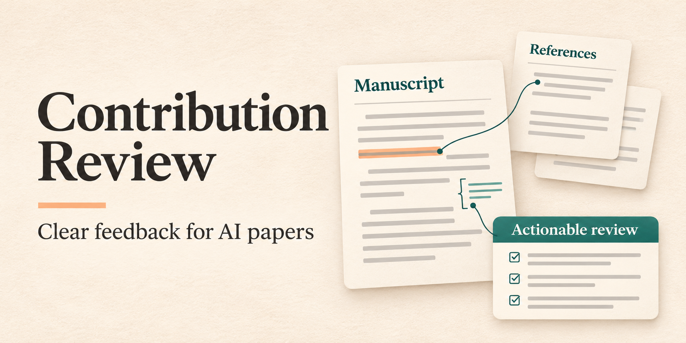
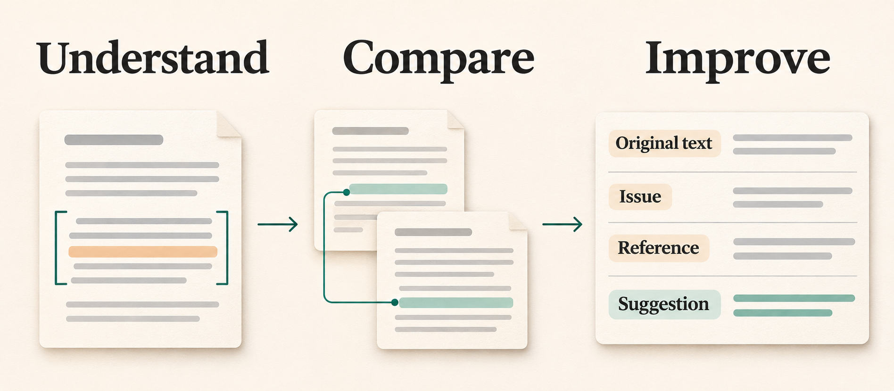

# Contribution Review · AI 论文贡献评审

**用具体、可溯源的意见，改进 AI／机器学习论文的 contribution。**

[English](README.md) · 简体中文

[](SKILL.md)
[](references/scoring.md)
[](references/output-format.md)



先理解作者实际增加了什么，再定位需要补清的连接，把判断落到可执行的修改。相关已发表论文用于说明建议背后的写作动作。

[本地安装](#本地安装) · [快速开始](#快速开始) · [阅读虚构评审示例](examples/review.md)

## 能做什么

| 重点 | 你会得到什么 |
| --- | --- |
| **贡献定位** | 辨清比较起点、新增认识或能力、成立范围与意义，区分中心主张、独立贡献和支持展示。 |
| **可执行意见** | 在每条意见旁放齐原文定位与短摘录、问题及实际影响、可比论文段落，以及最小修改动作。 |
| **有出处的范例** | 通常选用 1–3 篇承担相同写作任务的一手范例，附原文链接与紧凑的样本索引。 |
| **灵活的请求** | 支持段落、列表、多版比较及局部提问；改写、评分、JSON 都按需提供。 |

默认任务是**贡献表达与论证评审**，会按需阅读摘要、引言或图表，以理解实际主张。整篇审稿、事实核验和系统查新需要另行提出。缺少实验或证明本身不自动构成表达缺陷；明确标注的计划与假说按其实际状态评价。

## 快速开始

安装后，调用技能并提供贡献原文及理解它必需的上下文：

```text
请用 $contribution-review 审阅以下 contribution。
用中文回复。先给简短总览，再逐项定位重要问题，
对照相关已发表论文的具体段落，给出最小修改建议。

[在这里粘贴贡献原文与必要上下文。]
```

常用补充要求：

| 目的 | 在提示中加上 |
| --- | --- |
| 比较两版 | “先独立评价 A、B，再说明内容、力度与成立条件发生了什么变化。” |
| 请求评分 | “另给贡献部分 ARR 式评分，并说明为什么不选最接近的另一档。” |
| 请求改写 | “给出可替换段落，保留原有事实与条件。” |
| 结构化输出 | “使用 `references/review-schema.json` 输出 JSON，不给数字评分。” |
| 离线评审 | “不要联网，只评审所给文本，并将外部范例标为未核验。” |

技能本体使用中文编写，可在提示中指定希望使用的回复语言。

## 本地安装

本仓库本身就是一个独立技能目录，包含指令、参考资料和界面元数据；技能本身不要求安装依赖包或配置 API key。完整评审使用所在 Codex 环境提供的联网检索能力。

个人安装可将仓库克隆到 `~/.agents/skills/contribution-review`：

```bash
mkdir -p "$HOME/.agents/skills"
git clone https://github.com/hamster111111/contribution-review-skill.git \
  "$HOME/.agents/skills/contribution-review"
```

<details>
<summary>Windows PowerShell</summary>

```powershell
New-Item -ItemType Directory -Force (Join-Path $HOME ".agents/skills") | Out-Null
git clone https://github.com/hamster111111/contribution-review-skill.git (Join-Path $HOME ".agents/skills/contribution-review")
```

</details>

如果只供当前项目使用，将完整目录放在 `<project>/.agents/skills/contribution-review/`。保留 `SKILL.md`、`agents/` 和 `references/` 的相对位置。

Codex 会自动发现这些位置的本地技能；未显示时可重启 Codex。在 CLI 或 IDE 扩展中，可输入 `$contribution-review` 或通过 `/skills` 选择。安装位置与调用方式见 [OpenAI 官方技能文档](https://learn.chatgpt.com/docs/build-skills#where-codex-loads-local-skills)。

## 评语长什么样



默认输出可读的 Markdown：

1. **简短总览**：idea、总体判断，以及值得保留的具体价值。
2. **逐项意见**：原文定位与短摘录 → 问题或优点 → 可比论文段落 → 修改动作。
3. **样本索引**：统一使用 `S1`、`S2` 等编号，列出原文位置与链接。

通常重点展开最重要的 1–2 项；没有必改项就明确说明，可选润色保持为可选。

> **虚构示例预览：**“题目标签描述任务需要哪些证据，不能直接推出模型实际使用了哪些证据。应保留基于标注的分析能力，将模型证据使用的主张收窄到所给文本已建立的范围。”

查看[完整虚构示例](examples/review.md)、[输出结构](references/output-format.md)或[可选 JSON schema](references/review-schema.json)。示例不含私人稿件内容或编造的实验结果。JSON 只是按需使用的交付格式，请求 JSON 本身不触发评分。

## 如何选择范例

完整评审通常打开论文原文，以少量范例解释当前意见：

- **核验发表状态。** 正面核心范例默认来自相关领域顶会已录用的主会论文；Findings、workshop、预印本及待发表论文保留其真实标注。
- **优先匹配写作任务。** 段落应能解释相同问题：新增认识如何表达、方法增量如何定位、资源增加什么能力，或主张怎样限定范围。
- **采用滚动时间窗口。** 先检索当前与前一发表年份，不足时扩到再前一年；相关性和段落质量相近时优先更近的正式发表版本。较旧范例可用于说明明确的历史或解释目的。
- **机构偏好用于同等条件下选例。** 其他条件相近时，偏好知名 AI 企业、研究 Lab 或高校团队；依据发表时署名核验，并如实说明联合工作。机构声望不影响待评稿的判断。

来源就近放在对应意见旁。录用、奖项和公开审稿分数只作背景，不证明某个句子导致录用，也不决定另一篇稿件应得的分数。搜索使用公开主题词，不提交完整未公开段落。联网不可用或用户明确禁止时，会说明限制并继续评审。详见[检索、选例与引用规则](references/online-exemplars.md)。

## 按需 ARR 式评分

仅在明确要求评分时给数字，使用 **1–5、半分档位**，评估所给贡献及必要上下文，并解释所选档位及最接近的另一档。

这是本技能制定的**局部适配**，不代表 ARR 官方评分细则或背书。ARR 的[官方总体建议](https://aclrollingreview.org/reviewform#overall-assessment)面向整篇论文，本技能评分只针对贡献表达。它不预测录用或获奖，不核验完整研究，不平均辅助维度，也不换算历史 1–10 分。具体定义见[评分说明](references/scoring.md)。

## 目录结构

```text
contribution-review-skill/
├── SKILL.md                         # 工作流与范围
├── agents/openai.yaml               # Codex 界面元数据
├── references/
│   ├── output-format.md             # 可读评语结构
│   ├── online-exemplars.md          # 检索与引用规则
│   ├── scoring.md                   # 按需 ARR 式适配
│   ├── review-schema.json           # 可选结构化输出
│   ├── exemplar-catalog.md          # 检索起点，不作评分锚点
│   ├── exemplar-evidence.json       # 公开来源记录
│   └── affiliation-evidence.json    # 发表时机构署名
├── examples/review.md                # 明确标注的虚构评审
└── docs/assets/                     # README 配图
```
